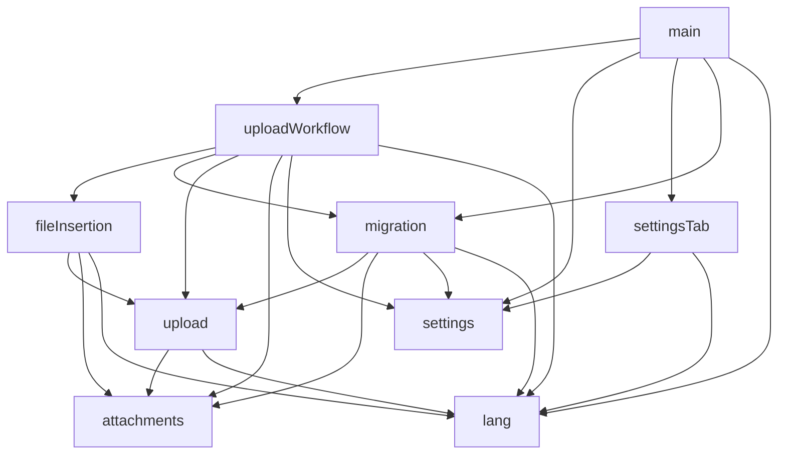

# Attachment Uploader Architecture

Desktop-only Obsidian plugin in one package. Per-note sessions, paste and drop, and batch migration share one upload queue. Terms live in `docs/GLOSSARY.md`.

## Stack

**App**: Obsidian desktop plugin (`isDesktopOnly`)
_Avoid_: mobile

**Language**: TypeScript

**Toolchain**: bun and vite-plus. `check` reads; `fix` rewrites. The release build runs `tsc --noEmit`, then the vite-plus bundle.
_Avoid_: ESLint, Prettier, Biome, a second test runner

**Markdown**: `mdast-util-from-markdown` and `micromark` for standard images. Wiki embeds are merged in `src/attachments/`.
_Avoid_: treating every Obsidian link syntax as an attachment

## Layers

- `src/attachments/` imports nothing outside that folder
- `src/upload/` imports nothing from `migration`, `fileInsertion`, or `uploadWorkflow`
- `src/migration/` imports nothing from `uploadWorkflow` or `fileInsertion`
- `src/settings.ts` imports nothing else under `src`
- Only `main` imports `uploadWorkflow`
- The upload executable starts only in `src/upload`
- A recovery receipt is written only in `src/upload`

## Layout

- `src/main.ts`: plugin lifecycle only
- `src/uploadWorkflow.ts`: composition root and the per-note session
- `src/fileInsertion.ts`: pasted and dropped files
- `src/settings.ts`: settings values and their serialization
- `src/settingsTab.ts`: settings UI
- `src/attachments/`: find references and rewrite them. No upload and no download
- `src/upload/`: the upload queue, remote-image download, local attachments, and recovery receipts
- `src/migration/`: batch migration. The modal is a view; closing it does not own or cancel the task
- `src/lang/`: user-facing strings. `en.ts` owns the keys
- `tests/`: unit tests for the modules above
- A new folder under `src/` needs a line in this list first

## Seams

**Uploader** (`src/upload`): runs the upload command. One queue serializes runs.
_Adapters_: the process runner, a test double

**MigrationBackend** (`src/migration`): the vault access behind batch migration. Preparing a plan does not upload.
_Adapters_: the vault adapter, a test double

**ImageTransferService** (`src/upload`): transfers remote images in one document.
_Adapters_: the open note, the batch-migration document; the real downloader, a test double
